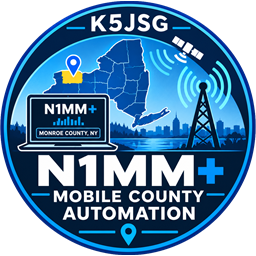

# N1MM Mobile County Automation



A Windows tool for mobile and rover operators in **state QSO parties**. It reads your GPS, works out which county you are in, and keeps N1MM Logger+'s **Rover QTH** in step with it automatically, so you never have to stop and type the county while driving.

Built by Jeremy S. Gaynor, K5JSG, for the New York QSO Party and since extended to 51 QSO parties.

## Features

- **Auto-select county.** Reads an NMEA GPS (serial/USB/virtual COM port), finds the county offline from embedded Census boundaries, and on a county change focuses N1MM+, presses **Ctrl+H**, fills in the "Enter the new Rover QTH" prompt and clicks OK. The prompt is hidden the instant it opens, nothing flashes, and it waits for a pause in keyboard/mouse activity first so it never steals a keystroke. Focus goes back to whatever was in front.
- **Follows N1MM+.** The county list (and county codes) switch to the QSO party you have open in N1MM+, or you can pick a party by hand.
- **Compact strip** at the bottom right of the screen, above the taskbar clock: county code and name, flashing amber/red on every change. Click it to send the county now; right-click for the menu (party, GPS port, auto-switch, ...).
- **County lines.** Straddling a line? Right-click the strip > *"On the county line: switch to ALL/CAT"* (counties within 3 km are offered). It uses N1MM+'s `COUNTYLINE` command, shows `ALL/CAT`, and ends by itself when you move into a different county.
- **Debounced.** A new county must appear on 3 consecutive fixes before it is accepted, so GPS jitter on a county line does not flip-flop N1MM+.
- **Exch-box county name.** While you type a county, state or province code in N1MM+'s Exch box, a label at the top of the screen shows the full name.
- **Choose your GPS.** Right-click > GPS port / baud rate, or "None" to release the port for another program.
- **Closes with N1MM+.** The program exits a few seconds after N1MM+ closes (setting `ExitWithN1mm`).
- **County data updates.** About 20 seconds after it starts, the program looks (no login needed) at the `county-data` release on its GitHub page for newer county data. If there is some it asks **Update** or **Not now**; after Update it asks whether to update **all** the parties that have newer data or **just the current QSO party**. Not now means it asks again the next time the program starts. With no internet connection nothing is shown. Right-click > **County data** checks on demand or goes back to the data the program came with. Downloaded files are checked before they are used, and the data the program shipped with is always the fallback.

## Installation

Download the latest installer from the [Releases](../../releases) page and run it. The app is self-contained - no separate .NET runtime install is required. Installing needs administrator rights (it goes in Program Files); the program itself does not need them to run.

Running a newer installer upgrades the existing copy in place: Installed Apps keeps a single entry showing the new version, your shortcuts stay where they are, and any other installed copy of the app and any file an older version installed that the new one no longer ships is removed. Your settings and logs live in `%LocalAppData%\N1MM Mobile County Automation` and are never touched.

The installer is not code-signed, so Windows SmartScreen may warn on first run ("More info" > "Run anyway").

### First start

1. Right-click the small strip at the bottom right of the screen > **GPS port**, and pick the COM port your GPS receiver uses (and **GPS baud rate** if it is not 4800).
2. Open your QSO party log in N1MM+. The county list follows the contest N1MM+ has open.
3. If N1MM+ runs **as administrator**, start this program as administrator too: Windows blocks input into a higher-privileged window.

## QSO parties

Counties and county codes are embedded for **51 parties**, named as N1MM+ names them (its contest "SubType"):

- **United States, 43 state parties:** AL AZ AR CA CO DE FL GA ID IL IN IA KS KY LA ME MD-DC MI MN MS MO MT NE NV NH NJ NM NY NC ND OH OK OR PA SC SD TN TX VT VA WA (Salmon Run) WV WI
- **Multi-state:** 7th Call Area (AZ ID MT NV OR UT WA WY) and New England (CT ME MA NH RI VT)
- **Canada:** Canadian Prairies (65 federal electoral districts), British Columbia (43 districts), Ontario (50 counties/districts/regions), Quebec (17 administrative regions), Atlantic Canada (NL divisions, PE/NB/NS counties)
- **Hawaii** (14 districts, each a group of ZIP codes on the sponsor's multiplier maps).
- **Not included:** Alaska (the party is currently inactive).

How the party is chosen: N1MM+ records the open contest in its `N1MM Logger.ini` (`RecentContest 1=QSOPARTY|...|NY`). The app re-reads that every few seconds, so opening another party's log switches the county list within seconds. A contest that is not a QSO party (DX, POTA, ...) leaves the list as it is. Right-click the strip > **QSO party** to pick one by hand (`QsoParty=TX` in the settings; `QsoParty=auto` follows N1MM+). `N1mmIni=` names the ini if it is not under `Documents\...\N1MM Logger+`. `--n1mm-contest` writes `n1mm-contest.txt` showing what the app sees.

The county code sent is the one N1MM+ accepts for that party (e.g. `ALB` for NYQP, `ALAM` for CQP, `HARR` for Harris County in the Texas party, `IDADA` for the 7th Call Area). Multi-state parties show `Name, ST` on the strip. Virginia's independent cities, Baltimore, St. Louis and similar cities are separate "counties" with their own code, as in the party rules.

**Accuracy.** The New York codes are the official NYQP ones. For the other parties N1MM+'s lists only contain the codes, so each code was tied to the county it abbreviates by matching the letters and the list's county-name order (see `tools/BuildPartyData`), with a short list of hand overrides. Close calls are flagged in the tool's `review.txt`. Then every party was checked code-by-code against the sponsors' own published tables (about 4,000 codes). That check found two real errors, both now fixed: St. Louis City is `STL` and St. Louis County is `SLC` in Missouri, and Baltimore City is `BAL` and Baltimore County is `BCT` in Maryland - the reverse of what the letters suggest. Everything else agreed. The strip still shows the county name beside the code, so please open an issue if one looks wrong. Hawaii's districts are groups of ZIP codes on the sponsor's maps, so they follow Census ZIP-area boundaries; empty country with no ZIP area (the volcano summits, Haleakala, Kauai's interior) goes to the nearest district. Lanai is `LAN`, the code N1MM+ accepts (the sponsor's map says LNI). Whether N1MM+ accepts a Rover QTH for a given party is up to N1MM+; if it shows an error box the app reports it on the strip.

## Settings

`N1MMMobileCountyAutomation.ini` in `%LocalAppData%\N1MM Mobile County Automation` (created on first run; edit it while the app is closed): `ComPort`, `BaudRate`, `QsoParty`, `N1mmIni`, `AutoSwitch`, `ConfirmFixes=3`, `AlwaysOnTop`, `Beep`, `ShowBar`, `StartMinimized`, `FlashSeconds=15`, `IdleSeconds=1.5`, `N1mmProcessName=N1MMLogger.net`, `ExitWithN1mm=True`, `ExchLookup=True`, `CheckCountyData=True`, `CountyDataUrl` (empty = the GitHub page). Updated county data is kept in a `county-data` folder beside the settings. A copy with a `portable.txt` (or the settings file) next to the exe keeps its settings and logs there instead.

Two logs sit beside the settings: `county-changes.log` (every county change) and `diagnostics.log` (errors, send results and any time the strip stopped responding, with the step it was stuck on - read it first if something misbehaves on a drive).

## Sharing one GPS between programs

A serial port can be opened by only one program at a time. To feed one receiver to several programs, use virtual ports: [com0com](https://com0com.sourceforge.net/) pairs plus `hub4com` copying the real port to the "B" side of each pair, with each program opening the "A" side:

`hub4com.exe --baud=... --octs=off --route=0:All \.\COM2 \.\CNCB0 \.\CNCB1 ...` (run it at boot from a scheduled task with highest privileges). Pairs: `setupc.exe change CNCA0 PortName=COM7,EmuBR=yes,EmuOverrun=yes` (`B` sides: `PortName=CNCB0,EmuOverrun=yes`). Renaming a port needs a reboot before further com0com changes. Many laptop GPS modems only stream NMEA during a tracking session; consult the modem's documentation.

## Command line

- `--replay file.nmea` - practice run from a recorded NMEA file instead of the serial port (`practice/practice-drive.nmea` drives Albany to Manhattan)
- `--n1mm-contest` - reads N1MM+'s ini only and writes `n1mm-contest.txt`
- `--selfcheck [resultfile]` - verifies every Windows API import resolves (touches no windows); run after any change to `NativeMethods.cs`
- `--send-test ALB [resultfile]` - push one county to N1MM+ and exit (**drives the real N1MM+ window**)
- `--send-countyline MON,ORL` - try the county-line command in N1MM+ (result in `countyline-test.txt`)
- `--dump-n1mm [seconds]` - read-only survey of N1MM+'s controls into `dump-n1mm.txt`

GUI tests that take focus or send keystrokes should not be run on a live operating desktop.

## How it talks to N1MM+

- N1MM+ is a WinForms program whose control ids change on every run, so controls are found by their labels and geometry (the Exch box via its "Exch" label, and so on).
- N1MM+'s entry-window **title bar also says "Rover QTH: XXX"**, so the Ctrl+H prompt is recognised only as a separate window with the prompt label, an edit box and an OK button. The sender never types blind.
- A county line cannot go through Ctrl+H ("Invalid county" for `MON/ORL`). The app types `COUNTYLINE` into the empty call sign box, presses Enter, hides the pop-up, enters `MON,ORL` (comma separated), clicks OK, then checks that both counties appear in the title bar. Any N1MM+ message box is read, closed and reported as a failure.
- Experimental and **off by default**: `VoiceMessageFile` rewrites the spoken county in an N1MM+ function-key (`.mc`) file, and `SaveFunctionKeys` tries to make N1MM+ reload it. On the real N1MM+ the SSB Message Editor's Save button stays disabled unless real keystrokes are typed, so N1MM+ never takes the rewritten file in; use N1MM+'s own `{ROVERQTH}` / `{COUNTYLINE}` macros instead.

## Layout

| Path | What |
|---|---|
| `src/N1MMMobileCounty.Core` | NMEA parser, county locator (point-in-polygon), change debouncer, embedded per-party county data (`party_*.bin`, `parties.tsv`) |
| `src/N1MMMobileCounty.App` | WinForms app (.NET 8, Windows 10+): strip, details window, GPS sources, N1MM+ sender |
| `tools/BuildPartyData` | Rebuilds the per-party county data (Census shapefile + N1MM+'s `QSOParty.sec` + the Canadian boundary sources) |
| `tools/MakePracticeTrack` | Generates `practice/practice-drive.nmea` |
| `tools/FakeN1mm` | Stand-in N1MM+ entry window with the Ctrl+H prompt, for testing the sender |
| `tests/N1MMMobileCounty.Tests` | xUnit tests (lookup, parties, NMEA, debounce, practice drive) |
| `Installer/InnoSetup` | Inno Setup script and the optional "start N1MM+ and this program" launcher |

## Building from source

Requirements: [.NET 8 SDK](https://dotnet.microsoft.com/download) (Windows) and, optionally, [Inno Setup](https://jrsoftware.org/isdl.php) to build the installer.

```powershell
dotnet build N1MMMobileCountyAutomation.sln
dotnet test N1MMMobileCountyAutomation.sln
```

To produce a self-contained release build and installer:

```powershell
.\build.ps1 -Version <version>
```

This publishes a self-contained, single-file executable to `publish\` and, if Inno Setup is installed, builds the installer into `dist\`.

Rebuilding the county data (rarely needed): `BuildPartyData cb_2024_us_county_500k.shp QSOParty.sec <dir> overrides.txt --fed ED_CF.shp cp_names.tsv --census <dir of GeoJSON> on_names.tsv ac_names.tsv qc_names.tsv --hawaii cb_2020_us_zcta520_500k.shp hi_zips.tsv`, then copy the output into `src/N1MMMobileCounty.Core/Data`.

## Releasing

Bump `Version` in `src\N1MMMobileCounty.App\N1MMMobileCounty.App.csproj`, commit, then push a version tag:

```powershell
git tag V1.1.0
git push origin master V1.1.0
```

Pushing a `V*.*.*` tag runs `.github\workflows\release.yml` on GitHub Actions, which builds the exe and installer itself (via `build.ps1`) and publishes the release.

## Data sources and credits

- US county and ZIP code tabulation area boundaries: US Census Bureau cartographic boundary files (public domain).
- Canadian boundaries: Elections Canada federal electoral districts (2023) and Statistics Canada 2021 cartographic boundary files, both under the Open Government Licence - Canada.
- County codes: the lists N1MM Logger+ itself uses for each QSO party; the Canadian Prairies, Ontario and Atlantic Canada name lists come from those parties' own multiplier pages. See [THIRD-PARTY-NOTICES.md](THIRD-PARTY-NOTICES.md).
- N1MM Logger+ is by Tom Wagner, N1MM, and is not affiliated with this project.

## License

GNU General Public License v3.0 - see [License.txt](License.txt).
